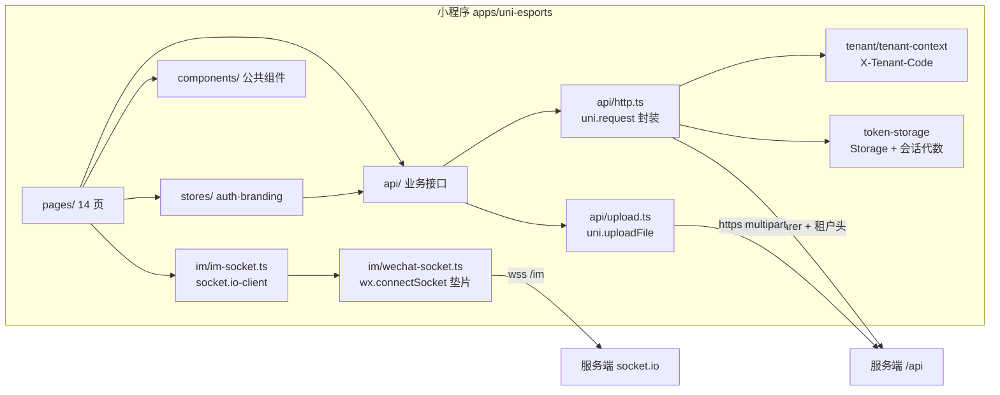
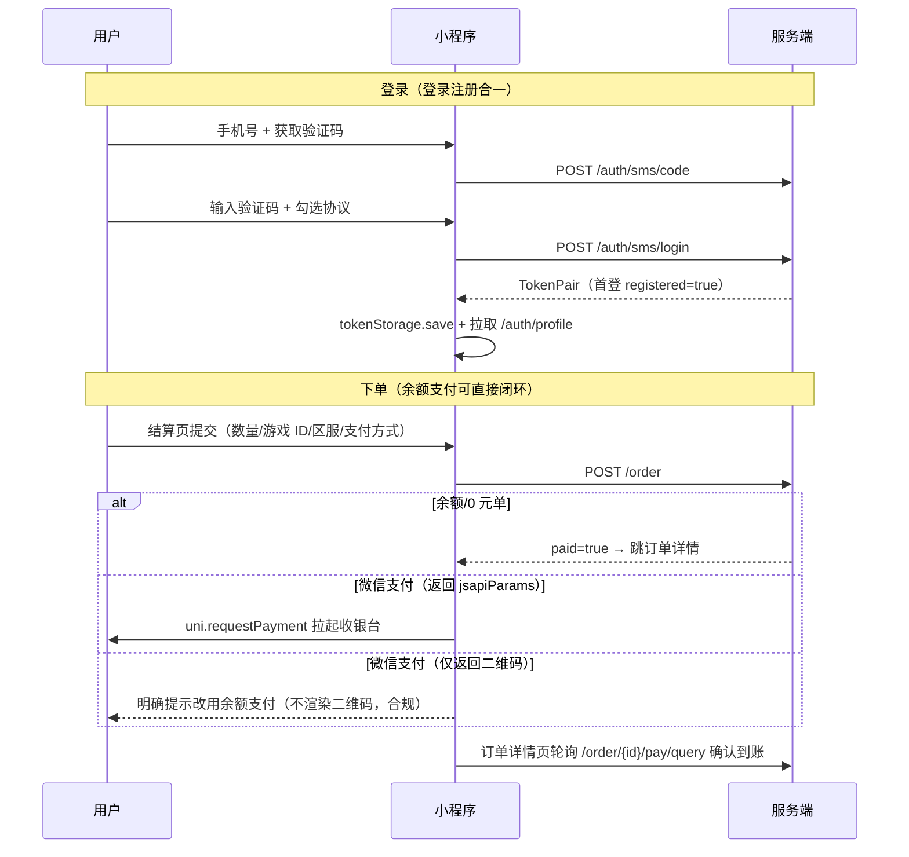

# 微信小程序端（apps/uni-esports）

## 1. 功能目标与非目标

**目标**

- 基于 uni-app（Vue 3 + Vite + TypeScript + Pinia）提供 C 端**微信小程序**（仅 `mp-weixin`，用户明确要求暂不考虑 PC/H5 端），与 `apps/client` 共用同一后端与 `packages/contracts` 共享契约，视觉延续「深空黑蓝 + 战术金」战术电竞风。
- **满足微信小程序上架要求**为第一优先级：
  - 隐私合规：manifest 开启 `__usePrivacyCheck__`，隐私 API（相册/相机）由微信官方隐私弹窗在调用前拦截；登录页与「我的」页提供《用户协议与隐私政策》页面。
  - 不强制登录即可浏览首页/分类/商品详情；消息/我的两个 tab 未登录时展示「去登录」引导而非空白强跳。
  - 支付合规：小程序内**不渲染二维码、不引导外部扫码或转账**；微信支付仅通过 `uni.requestPayment` 拉起收银台（代码就绪，依赖服务端小程序支付渠道，见「未实现项」）。
  - tabBar 图标为 81×81、<1KB 的合规 PNG（由 `scripts/gen-tabbar-icons.mjs` 生成，可复现）。
  - 生产构建不含 vConsole、不含 `console` 调试入口。

**已实现页面（14 页）**

| 模块 | 页面 | 说明 |
| --- | --- | --- |
| 登录 | `pages/login/login` | 手机号+短信验证码（登录注册合一），协议勾选强制、冷却倒计时 |
| 首页 | `pages/home/home` | 横幅轮播、公告滚动条、分类签、双列商品流（分页加载） |
| 分类 | `pages/category/category` | 左右布局：分类侧栏 + 商品列表 |
| 商品 | `pages/product/detail` | 封面、价格（按区服最低「起」价）、富文本详情、分享 |
| 下单 | `pages/order/checkout` | 区服/数量/游戏 ID/备注、余额或微信支付、合计实时计价 |
| 订单 | `pages/order/list` `pages/order/detail` | 状态筛选分页列表；详情含取消、支付结果轮询（`pay/query`）、退款申请 |
| 钱包 | `pages/wallet/wallet` | 余额、预设金额充值（微信收银台）、流水分页 |
| 消息 | `pages/message/message` | 会话列表（未读角标、最后消息摘要）、发起客服会话 |
| 聊天 | `pages/chat/chat` | WebSocket 实时收发、历史消息、已读回执、图片消息预览 |
| 我的 | `pages/profile/profile` | 微信头像昵称填写能力改头像、昵称编辑、功能入口、退出登录 |
| 通知 | `pages/notice/list` `pages/notice/detail` | 平台通知列表/富文本详情 |
| 协议 | `pages/agreement/agreement` | 用户协议与隐私政策（配置中心富文本） |

**非目标（本期不做）**

- 打手侧（接单大厅、打手订单中心、打手入驻）、优惠券、邀请、会员等级、排行榜、福利活动、投诉反馈、实名认证、提现（支付宝/银行卡渠道无小程序场景）。
- 服务端改造：小程序登录（`wx.login` code2session 换 openid 自动注册）与小程序支付渠道（WX_LITE），见「未实现项与上架硬依赖」。
- 支付宝/支付宝二维码等与小程序审核冲突的支付引导。

## 2. 目录结构与分层职责

```text
apps/uni-esports/
├── package.json               # @app/uni-esports，接入 pnpm workspace 的 build/lint/typecheck/test
├── vite.config.ts             # uni() 插件 + @ 别名（preserveSymlinks: false 适配 pnpm）
├── vitest.config.ts           # 独立单测配置（不加载 uni 插件）
├── tsconfig.json / env.d.ts   # 严格 TS，@dcloudio/types
├── scripts/gen-tabbar-icons.mjs  # tabBar 图标生成（纯 Node zlib 手写 PNG，无绘图依赖）
└── src/
    ├── main.ts / App.vue      # 入口：注入 WebSocket 垫片、Pinia、租户初始化、品牌加载、全局样式
    ├── manifest.json          # mp-weixin appid、__usePrivacyCheck__、lazyCodeLoading
    ├── pages.json             # 14 页注册 + tabBar（4 tab + 图标）
    ├── uni.scss               # 设计令牌（与 apps/client 一致）
    ├── config/env.ts          # VITE_API_BASE_URL / VITE_WS_BASE_URL / VITE_TENANT_CODE
    ├── tenant/                # 租户上下文（构建时固定，扫码参数可覆盖）
    ├── api/                   # http.ts（uni.request 封装）+ 各业务 api + token-storage
    ├── stores/                # auth.store（登录态/资料/过期联动）、branding.store
    ├── im/                    # wechat-socket 垫片 + im-socket（socket.io-client /im 命名空间）
    ├── composables/           # use-require-login（页面级登录守卫）
    ├── components/            # goods-card / empty-state / pay-method-picker / refund-request
    ├── utils/                 # toast、format（fen↔元、时间）
    └── pages/                 # 14 个页面
```

设计要点：

- **HTTP 层**（`api/http.ts`）：与 `apps/client` 同语义——统一响应解包、`X-Tenant-Code` 头、401 时按会话代数去重静默刷新一次并重放、错误统一 toast（`silent` 可关）、`HttpError(status, bizCode)`；`200 + code=401` 的回包也归一化为 401 处理。
- **令牌存储**（`api/token-storage.ts`）：uni Storage + 会话代数（generation）防并发刷新/登出竞态；auth store 监听 `onAuthExpired` 统一清理。
- **租户**（`tenant/tenant-context.ts`）：小程序无地址栏，`VITE_TENANT_CODE` 构建时固定归属；仅带 `tenantCode` 的扫码/场景参数可覆盖并持久化；构建配置存在时不读历史持久化值，避免串租户。
- **IM**（`im/`）：`socket.io-client@4.8.1` 与服务端同版本，websocket-only 传输；`wechat-socket.ts` 以 `wx.connectSocket` 的 SocketTask 实现 `WebSocket` 语义垫片（onopen/onmessage/onerror/onclose/send/close），在 `main.ts` 最早注入。
- **页面守卫**：`composables/use-require-login.ts`，tab 页 `redirect=false` 展示引导、子页 `redirect=true` 直接跳登录页。

## 3. 模块结构图



## 4. 关键业务时序



IM 时序：页面加载 → `io(wss://…/im, { auth: { token } })` 握手 → `im:join` 拉历史 → `im:send` 发送、服务端 `im:receive` 广播回显 → 对端消息展示后 `im:mark-read` 推进已读位点。事件名与载荷全部来自 `packages/contracts` 的 `IM_EVENTS`。

## 5. 配置与部署

- **环境变量**（复制 `.env.example` 为 `.env.local`）：
  - `VITE_API_BASE_URL`：REST 基址（含 `/api`），必须 **https**；
  - `VITE_WS_BASE_URL`：IM 基址，必须 **wss**；
  - `VITE_TENANT_CODE`：小程序绑定的租户编码（默认 `default`）。
- **微信小程序后台（mp.weixin.qq.com）必须配置**：
  1. 「开发设置 → 服务器域名」：request 合法域名 = API 域名；socket 合法域名 = WS 域名；uploadFile 合法域名 = API 域名。域名须 HTTPS 且已 ICP 备案。
  2. 「设置 → 服务内容声明 → 用户隐私保护指引」：声明并启用（相册/摄像头/头像昵称等），否则隐私 API 调用会被拒绝。
  3. 「设置 → 基本设置 → AppID」填入 `src/manifest.json` 的 `mp-weixin.appid`（当前为空，构建产物显示 `touristappid` 仅供体验）。
- **本地运行/构建**：

```bash
pnpm install --filter @app/uni-esports --filter @app/contracts
pnpm --filter @app/contracts build          # 产物依赖，先构建
pnpm --filter @app/uni-esports dev:mp-weixin  # 开发：微信开发者工具导入 dist/dev/mp-weixin
pnpm --filter @app/uni-esports build          # 产物：微信开发者工具导入 dist/build/mp-weixin
```

## 6. 安全与合规边界

- 令牌、租户码仅存小程序 Storage，不上报日志；HTTP 层不打印请求头/响应体。
- 所有业务输入（手机号 `CHINA_MOBILE_PATTERN`、游戏 ID `^\d{1,32}$`、备注长度）与服务端 DTO 共用 `packages/contracts` 约束。
- 上传图片走登录态 `/upload/self`，8MB 上限；头像使用微信「头像昵称填写能力」临时文件，不调用已废弃的 `getUserProfile`。
- 支付金额一律以服务端返回为准（分），前端不做金额运算之外的资金逻辑；渠道支付结果以 `pay/query`、`recharge/{no}/status` 服务端查单收敛，同步拉起成功不作为入账依据。

## 7. 测试范围与验证结果

- 单测（vitest，`src/**/*.spec.ts`）：`utils/format`（分↔元换算、时间格式化 8 例）、`tenant/tenant-context`（场景参数>构建配置>持久化>默认、非法编码拒绝 5 例）。
- 实际执行结果（本仓库根目录）：

```bash
pnpm --filter @app/uni-esports typecheck   # vue-tsc 通过
pnpm --filter @app/uni-esports lint        # eslint --max-warnings=0 通过
pnpm --filter @app/uni-esports test        # 2 files, 13 tests 全部通过
pnpm --filter @app/uni-esports build       # uni build -p mp-weixin 成功，产物 dist/build/mp-weixin
```

- 未覆盖：真机/开发者工具端到端（支付拉起、socket 收发、隐私弹窗），需在配置好 appid 与合法域名后由开发者工具实测。

## 8. 未实现项与上架硬依赖（务必阅读）

1. **小程序支付渠道（上架硬依赖）**：服务端支付驱动目前仅有微信扫码（WX_NATIVE）、公众号 JSAPI、支付宝；小程序内 `wx.requestPayment` 需要使用**小程序 appid + 用户小程序 openid** 签名的 `jsapiParams`。当前服务端不会返回该参数，因此小程序端充值/微信支付提交后会明确提示改用余额，**微信审核要求虚拟服务交易在小程序内闭环（微信支付）**，需在服务端：
   - 增加小程序 `code2session` 登录端点（`/auth/wechat/mini/login`），并把小程序 openid 存入微信身份（现 `wechat_identity` 为单 openid，需扩展渠道维度）；
   - 支付网关增加 WX_LITE 驱动（计全付 jeepay 协议 `wayCode=WX_LITE`），订单/充值复用既有 `PaymentGatewayService` 路由。
   前端 `uni.requestPayment` 接入与降级提示已就绪，服务端参数到位即生效。
2. **小程序登录**：当前用短信验证码登录（可用、合规）。微信一键登录依赖上述 code2session 端点。
3. **Socket.IO 在小程序端的兼容性**：`wechat-socket` 垫片覆盖 websocket-only 传输所需子集，需真机验证长连接稳定性；异常时聊天退化为「发送后广播回显」，历史消息仍可拉取。
4. **审核注意**：提交审核前需在管理端配置品牌名称、用户协议正文；商品/公告内容避免诱导外部交易文案；若审核要求演示完整支付流程，需先完成第 1 项或提供带余额的测试账号。
5. 打手侧、优惠券、邀请、会员、排行、活动、反馈、实名等模块未移植（页面未注册，不出现空壳入口），按需后续迭代。
